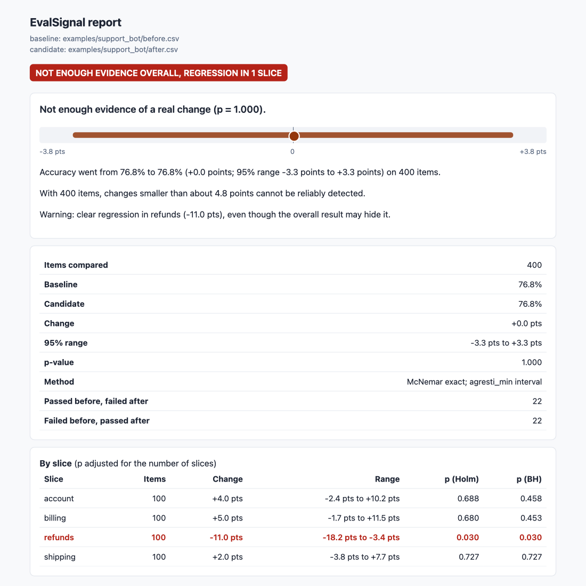

# EvalSignal

**Is an AI change a real improvement or just noise?** You changed a
prompt, a model or a retrieval setting, reran your test cases, and the
score moved from 82% to 79%. EvalSignal tells you whether that move is
real, how sure you can be, and, if your test set is too small to tell, how
many test cases you would need.

```
$ evalsignal compare examples/small_eval/before.csv examples/small_eval/after.csv
NOT ENOUGH EVIDENCE

Not enough evidence of a real change (p = 0.125).
Accuracy went from 60.0% to 70.0% (+10.0 points; 95% range -0.5 points to +19.6 points) on 40 items.
40 items are too few: with only 10% of items changing result, even the largest possible change could not be reliably detected.
```

A ten-point jump on 40 test cases looks like a win, but only four cases
actually changed result. EvalSignal says so instead of declaring victory.

## Why

Most evaluation tools run your test cases and show a pass rate. Comparing
two pass rates by eye has three common failure modes:

1. **Small test sets mislead.** On 50 random MMLU questions, "the higher
   score wins" picked the wrong model 7.2% of the time, even for a change
   as large as 8.9 points ([results](docs/results.md#2-a-real-model-change-mistral-7b-base--mistral-7b-instruct)).
2. **Averages hide broken areas.** An overall score can stay flat while
   one category collapses; checking many categories by eye also produces
   false alarms by chance.
3. **"No significant change" is not "no change".** A test that cannot see
   a difference is not evidence that there is none.

EvalSignal compares the two runs **item by item** (paired statistics,
which are far more sensitive than comparing two averages) and gives one
of four answers, checked in this order:

| Answer | Meaning |
|---|---|
| `no_meaningful_change` | The whole 95% range lies within the margin you said does not matter (`--margin`). Checked first: with enough items even a tiny change is statistically detectable, and this says it is too small to matter. |
| `improvement` / `regression` | Otherwise, the change is clear (p < 0.05 by default). |
| `not_enough_evidence` | The data cannot tell. You get the smallest change this test set can detect and the size needed for the change you saw. |

It also checks every category (`slice`) with a correction for testing many
at once, and warns when one clearly regressed even if the overall result
looks fine (with `--margin`, a category whose whole range lies within the
margin does not count):



## Demo page

**Live demo: https://dcoding0308.github.io/evalsignal/** (no installation needed).

[`site/index.html`](site/index.html) walks through four examples (a clear
improvement, a small test set, a cheaper model with no meaningful change,
and a regression hidden in one category), a test-size planner, and the real
HTML report. It is a static page: every number was precomputed by the
command-line tool on made-up data, shown with the command that reproduces
it. Rebuild it with `uv run python site/build.py`.

## Install

Python 3.11+ and [uv](https://docs.astral.sh/uv/):

```bash
git clone https://github.com/dcoding0308/evalsignal && cd evalsignal
uv sync
uv run evalsignal --help
```

## Use

### 1. Compare two runs

Each run is a CSV or JSON-lines file with one row per test case:

```csv
id,passed,slice
refund-001,true,refunds
refund-002,false,refunds
billing-001,true,billing
```

| Column | |
|---|---|
| `id` | required; the same test case must have the same id in both runs |
| `passed` or `score` | `true/false` (pass/fail) or any number (a rating, a similarity score) |
| `slice` | optional category; results are also reported per category |
| `cluster` | optional group of related test cases (e.g. questions about the same document), resampled together |
| `run` | optional; when a case was run several times, its runs are averaged |

```bash
evalsignal compare before.csv after.csv                      # plain-text verdict
evalsignal compare before.csv after.csv --margin 2           # changes under 2 points don't matter
evalsignal compare before.csv after.csv --html report.html   # self-contained HTML report
evalsignal compare before.csv after.csv --format markdown    # for a pull-request comment
evalsignal compare before.csv after.csv --format json        # for scripts
evalsignal compare before.csv after.csv --fail-on-regression # exit code 1 on a clear regression
```

Test cases present in only one run are listed, never silently dropped.

### 2. Plan the size of a test set

```bash
$ evalsignal plan --disagree 15 --change 3
To detect a change of 3 points with 80% probability, when about 15% of items differ between versions: 1,362 items.

$ evalsignal plan --disagree 15 --items 200
With 200 items, when about 15% of items differ between versions, changes smaller than about 7.9 points cannot be reliably detected.
```

`--disagree` is the share of test cases whose result differs between the
two versions; a previous comparison shows it as "passed before, failed
after" plus "failed before, passed after".

### 3. Check an automatic judge against people

When a model grades answers ("which answer is better?"), check it against
human graders on the same items:

```bash
$ evalsignal judge examples/judge.csv --judge auto-judge
Judge 'auto-judge': 120 verdicts
  auto-judge vs people: 66.1% agree (range 58.2% to 73.8%, 248 comparisons); 87.0% when neither says tie; kappa 0.47
  people vs people: 76.3% agree (range 68.0% to 84.2%, 173 comparisons); 88.6% when neither says tie; kappa 0.62
  marked inconsistent when answers were swapped: 12.5%
The judge agrees with people less often (66.1%) than people agree with each other (76.3%, range 68.0% to 84.2%).
```

### In CI

[`examples/github-action.yml`](examples/github-action.yml) runs your
evaluation on `main` and on the pull request, posts the verdict as a PR
comment, and fails the check on a clear regression.

### From Python

```python
from evalsignal.paired import compare_binary
from evalsignal.verdict import decide

comparison = compare_binary(before_passed, after_passed)  # arrays of booleans, same order
print(decide(comparison, binary=True).headline)
```

## Results

Measured in [docs/results.md](docs/results.md), each with a script to
rerun it:

- **The statistics keep their promises.** In 30 simulated settings (2,000
  runs each), false alarms stayed at or below 5% (0.05% to 4.6%) and the
  default 95% range covered the truth 94.1% to 99.7% of the time. The
  common textbook sample-size formula under-delivered (77% to 80% power
  when 80% was promised), so EvalSignal checks its sample-size advice
  with exact power. Above 100,000 items it uses the approximation (accurate
  at that size) and says so in its output.
- **Related test cases matter.** With groups of related items, item-level
  tests raised false alarms 12.2% of the time; resampling whole groups
  brought this to 3.2%.
- **A real model change.** Mistral-7B → Mistral-7B-Instruct, per question,
  from archived Open LLM Leaderboard runs scored with raw `acc` (not the
  leaderboard's `acc_norm`, so headline numbers can differ): −8.9 points on
  MMLU (14,015 paired questions) and −4.5 on ARC-Challenge (1,170), both
  clear. Of 57 MMLU subjects, 37 look changed without correction and 18
  after Holm correction.
- **Small test sets.** With 50 random questions (2,000 draws), the naive
  "higher score wins" rule pointed the wrong way 7.2% of the time.
  EvalSignal made the correct call 15.6% of the time, said "not enough
  evidence" 84.4% of the time, and made a wrong call 0.05% of the time (1
  draw). With 200 questions it made the correct call 72% of the time and
  was never wrong.
- **LLM judges.** On MT-Bench, GPT-4 agreed with expert humans 66.2% of
  the time, about as often as two experts agree with each other (65.5%),
  but changed its verdict in 15.8% of cases when the two answers swapped
  places.

## How it works

| Situation | Method |
|---|---|
| Pass/fail, test | McNemar exact test (on the cases that changed result) |
| Pass/fail, 95% range | Agresti–Min interval for paired proportions, chosen from the simulation |
| Scores | Paired bootstrap interval; sign-flip permutation test |
| Grouped cases (`cluster`) | Bootstrap and sign-flip over whole groups |
| Many slices | Holm (any false alarm) and Benjamini–Hochberg (share of false discoveries) |
| Sample size | Exact McNemar power, starting from the normal approximation; above 100,000 items the approximation alone, flagged in the output |
| Judge vs people | Agreement by model identity with and without ties, Cohen's kappa, resampling by item |

Source: [`paired.py`](src/evalsignal/paired.py),
[`power.py`](src/evalsignal/power.py),
[`slices.py`](src/evalsignal/slices.py),
[`verdict.py`](src/evalsignal/verdict.py),
[`judge.py`](src/evalsignal/judge.py).

## How this differs from other tools

- **Promptfoo, DeepEval, OpenAI Evals, lm-evaluation-harness** run test
  cases and score answers. EvalSignal starts where they stop: it takes
  per-item results from any of them (or your own scripts) and answers
  "is the difference between two runs real?". It does not call models.
- **Standard errors in benchmark reports** describe one run's uncertainty.
  Comparing two runs item by item removes the variation shared by both,
  which is often most of it.
- The statistics are standard (McNemar 1947; Agresti and Min 2005; Holm
  1979; Benjamini and Hochberg 1995). The contribution is packaging them
  for evaluation results, checking them by simulation, and turning them
  into an answer someone can act on.

## Data

- `examples/` holds made-up data only (`examples/make_examples.py`).
- The case studies download public data into `data/` (not committed):
  MT-Bench human judgments (CC-BY-4.0) and Open LLM Leaderboard
  per-question details (no stated licence, so used locally only). Only
  derived statistics are published. See
  [docs/week1-data-audit.md](docs/week1-data-audit.md).

## Development

```bash
uv sync
uv run pytest            # 54 tests, a few seconds
uv run ruff check . && uv run mypy src
```

See [ROADMAP.md](ROADMAP.md) for what is planned and what was corrected
along the way.
